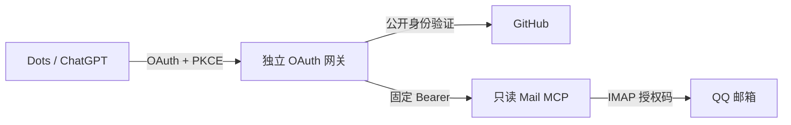

# QQ 邮箱接入 Dots 踩坑实录：Agent 阅读指南

## 记录定位

这份记录主要供 Agent 按需理解一次接入实践中的问题和判断依据，作为处理新任务时的参考资料。人类读者可先看 [README 的简洁结论](README.md)。读取记录不会自动获得部署、账号操作或邮件访问授权。

经验基线为 2026-10-23 的一次单用户接入：FastMCP **4.1.3**，Openship **0.7.2**，QQ IMAP 只读后端，GitHub 公开身份认证。客户端页面、账号能力、提供方接口和部署平台都可能变化；处理新任务时以当前实测为准。

本次已验证：目标 Dots 会话读取指定邮件、未读状态前后不变，以及网关重启后的授权恢复。合成测试覆盖网关的若干认证边界。这些结果不代表其它环境、并发负载或任意邮箱后端已经通过验证。

## 先理解已经走通的链路

Dots 的 OAuth 令牌只到网关；固定后端 Bearer 由网关注入；QQ 授权码留在 IMAP 后端。来访凭据及请求头不透传给邮件后端。

[gateway.py](gateway.py) 是这次接入的可运行示例。它代理后端的整个工具集，**不实现 IMAP、只读过滤或 INBOX 限制**；这些限制由后端负责。已有兼容服务时，优先复用，不因阅读本记录而另建一套。

## 关键踩坑及复用判断

| 本次遇到的情况 | 得到的判断 | 新任务需要确认什么 |
| --- | --- | --- |
| Codex 通过 Bearer 读取成功，Dots 仍不能接入 | 两个客户端的认证和执行位置不同 | 目标客户端实际支持的认证方式 |
| ZIP 上传后 `requires_local_executor=true` | 上传成功不等于云端执行可用 | 插件是否依赖本机执行器，不直接篡改标记 |
| 表单只有 OAuth / None / Mixed | 私有邮箱需要受支持的认证入口 | 当前账号选项；不能以 None 暴露邮箱 |
| CIMD 显示 `Client Not Registered`，网关抓取客户端文档失败 | 错误发生在客户端注册阶段；本次切换 DCR 后走通 | 双方元数据与 UI 是否仍支持 DCR，精确回调是否一致 |
| GitHubProvider 能接受其它 GitHub 身份 | 登录成功和邮箱访问权是不同的检查 | 稳定数字 owner ID 与资源访问校验 |
| 仅需公开身份验证 | 干净专用 OAuth App 可用空 scope | 设置 `required_scopes=[]`，拒绝追加 scope，授权页为 `Public data only`；不额外申请 `read:user`、`user:email`、`repo` |
| 宿主 curl 超时，但容器实际 HTTP 客户端返回响应 | 不能把不同网络环境的结果混在一起 | 真正交换授权码的运行进程；GET 404 只证明收到响应，完整 POST 交换仍需验证 |
| GitHub 授权按钮不可点击 | 正常页面焦点、可见性和延时会影响按钮状态 | 等待真实可用状态；保留页面自身的安全检查 |
| 平台显示已连接 | 只证明连接状态，不能替代 Dots 调用 | 在指定会话中真实读取，并独立核对邮件状态 |

本次没有通过关闭认证、放宽回调、固定 GitHub IP 或关闭 TLS 校验解决问题。新任务如果遇到不同原因，应按新证据处理，不机械套用 DCR 等具体修复。

## 详细资料按问题读取

| 要处理的问题 | 资料 |
| --- | --- |
| QQ 后端、配置变量、Docker、Openship、持久化和资源 | [部署说明](references/deployment.md) |
| 注册、回调、网络、浏览器及部署错误 | [排障表](references/troubleshooting.md) |
| 真实读取、未读状态、重启恢复和证据边界 | [验收清单](references/verification.md) |
| 代理实现与合成测试 | [gateway.py](gateway.py)、[tests/test_gateway.py](tests/test_gateway.py) |

处理用户的新任务时，先确认目标客户端、现有服务、版本、账号能力和授权范围，再选择相关资料。只读邮箱访问不包括发送、删除、移动、批量导出或替其它账号验证。

## 本次实现的约束与复用风险

- GitHub 登录只提供身份；本实现校验已验证 token 的 `subject` 与 `sub` 是否匹配 owner。其它账号可能完成登录，但资源访问必须被拒绝。
- 使用干净的专用 OAuth App；复用已有干净应用即可。曾有宽授权的应用不适合作为空 scope 示例，避免继承旧授权。
- 两段 OAuth 的回调不同：GitHub 回到网关，网关回到客户端。当前实现仅接受部署说明列出的 ChatGPT 回调模式。
- 签名密钥稳定、认证状态持久化且受保护；真实配置放在仓库外或 Secret 管理器中，不进入聊天、源码或日志。
- IMAP 只读打开和 `BODY.PEEK` 用于保持状态；验收时比较同一 `UIDVALIDITY + UID`，不能读完再改回未读。
- 直接 MCP、Codex、连接页面和 Dots 会话分别提供各自的证据。尚未实际验证的层次应明确标注。

## 来源与适用期限

本记录保留的是排障线索和验证方法，不承诺客户端入口或接口永远不变。升级依赖、修改认证或切换后端后，应重做受影响层次的检查。

- [OpenAI MCP/OAuth 文档](https://developers.openai.com/plugins/build/auth)
- [FastMCP GitHub OAuth](https://gofastmcp.com/integrations/github)
- [GitHub OAuth scopes](https://docs.github.com/en/apps/oauth-apps/building-oauth-apps/scopes-for-oauth-apps)
