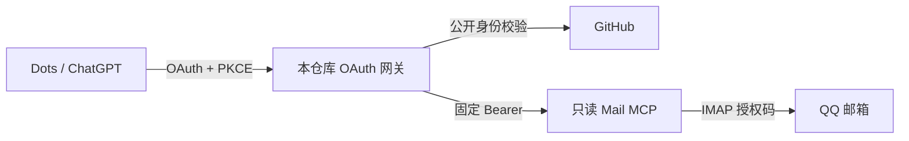

# QQ 邮箱接入 Dots：本次部署记录与复用注意

供 Agent 按需查阅的实录附篇。以下配置和命令对应 [本次示例实现](../AGENT-GUIDE.md)，复用前先确认当前版本、环境和授权范围。

## 最小拓扑



网关代理后端暴露的工具，**不会自动删掉写工具**。只连接经过 `tools/list` 检查的只读服务。一个可选后端是独立部署的 [mail-mcp-suite Reader](https://github.com/federicokalik/mail-mcp-suite)；不要同时开放它的写入服务。

## 邮箱后端的验证要点

在 QQ 邮箱当前设置中按官方流程开启 IMAP，必要的手机验证由用户完成。使用邮箱生成的授权码，不使用 QQ 登录密码。授权码留在后端 Secret 中；失败时确认验证流程和实际服务响应，不把“过期”提示一律归因于输入错误。

核对当前工具集、认证和来源。已验证过的 Reader 工具名是 `mail_list_mailboxes`、`mail_search`、`mail_get_message`；这是特定后端的接口，不是 MCP 标准。固定镜像 digest 和版本，升级后再查工具集和副作用。

## 示例网关的配置约束

Python 3.12，FastMCP 4.1.3。以下变量由 `gateway.py` 校验；必需值缺失时启动失败。

| 变量 | 内容 |
| --- | --- |
| `PUBLIC_BASE_URL` | 独立 HTTPS 网关 origin，如 `https://mail-gateway.example.com` |
| `OWNER_GITHUB_ID` | 所有者不可变数字 ID，通过 GitHub 公开用户资料核对 |
| `GITHUB_CLIENT_ID` / `GITHUB_CLIENT_SECRET` | 新建专用 OAuth App 的凭据 |
| `CHATGPT_REDIRECT_URI` | 当前客户端显示的精确回调 |
| `JWT_SIGNING_KEY` | 至少 32 字符的稳定高熵秘密，备份并限制访问 |
| `FASTMCP_HOME` | 可持久写入的绝对目录；容器默认 `/data/fastmcp` |
| `MAIL_BACKEND_URL` | 已有只读 MCP 地址；不能回指本网关。公网使用 HTTPS；HTTP 仅用于受保护的本地或私网链路 |
| `MAIL_BACKEND_TOKEN` | 后端固定 Bearer 的 token 部分，不含 `Bearer ` 前缀 |
| `MAIL_BACKEND_HOST` | 可选 Host 覆盖，默认取后端 URL 的 authority |

GitHub OAuth App 的回调是 `${PUBLIC_BASE_URL}/auth/callback`。ChatGPT 回调是另一段链路，应从当前客户端复制。支持 RFC 9207 时可能显示稳定地址 `https://chatgpt.com/connector_platform_oauth_redirect`；不要为套用示例而修改客户端给出的地址。

本实现只接受 `chatgpt.com` 下的 `/connector_platform_oauth_redirect` 或 `/connector/oauth/<id>`。若当前客户端提供其它合法回调，本实现尚不兼容；先依据当前官方约定更新校验和测试，再部署，不能直接放宽为任意地址。

不要复用曾授予宽权限的 GitHub OAuth App：省略 scope 可能继承旧授权。当前实现设置空 scope 并拒绝追加 scope。授权页仍必须实际检查。

## 本地或 Docker

创建隔离环境并安装锁定依赖：

```sh
python3.12 -m venv .venv
.venv/bin/python -m pip install --require-hashes -r requirements-test.txt
.venv/bin/python -m pytest -q
# 通过外部 Secret 或受保护的运行配置注入必需变量后：
.venv/bin/python gateway.py
```

把真实配置保存在仓库外的 Secret 管理器或私有运行目录。目录 `0700`、文件 `0600`；不要通过 `set -x`、完整环境输出或带凭据的命令行传递。

Docker 镜像以 UID/GID `10001:10001` 运行；挂载目录需允许该 UID 写入。构建平台必须匹配目标服务器：

```sh
docker build --platform linux/amd64 -t private-mail-gateway:local .
```

运行时注入上表变量，挂载持久目录到 `/data/fastmcp`，内部端口为 `8000`。通过已有反向代理对外提供 TLS；路由整个 origin，包括 `/.well-known`、`/authorize`、`/register`、`/token`、`/consent`、`/auth/callback` 和 `/mcp`。

`/healthz` 仅检查进程，不检查 GitHub 或邮箱。FastMCP 的授权状态使用稳定签名密钥派生的加密存储；丢失状态目录或更换密钥会影响既有授权。备份中仍包含敏感认证材料，按 Secret 保护。

## 本次 Openship 部署遇到的问题

检查当前安装版本、MCP 工具 schema、项目权限和服务器归属，再选择受支持操作；不要复制另一台机器的服务器 ID、OAuth 凭据或路径。

1. 读取候选服务器的架构、可用资源、80/443 占用、已有反向代理和域名配置。复用正常入口。
2. 新建或确认目标项目，明确绑定目标服务器。将变量作为 Secret 保存；不要把值内嵌到可见部署日志。
3. 部署预构建镜像，挂载持久状态目录，设置 HTTP/进程健康检查和资源上限。登记独立网关域名的 DNS 与 TLS。
4. 共享代理需要升级或重建时，先完成备份、检查配置兼容性和恢复方案，并取得该影响范围的授权。接入邮箱的授权不自动包含中断其它网站。
5. 某次 Openship 0.7.2 的代理重建会清理缺少 `server_name` 的附加 `.conf`。仅将其作为版本化排障线索：检查当前实现和加载结果，不能每次部署都盲目恢复旧配置。
6. 镜像拉取慢时，可在受信机器构建目标架构，再通过平台支持的上传或私有 SSH 转发传输。临时接收器只绑定 loopback，限制大小/超时，完成后删除隧道和临时文件，不开放公网上传端口。
7. 验证导入后的平台、镜像 config digest 与有序 RootFS DiffIDs。不同 Docker 存储格式的 manifest ID 和 config ID 可能不同，不因显示值不同就误判损坏。

资源容量按实测决定。一次单用户样本在 `192 MiB / 0.25 CPU` 上运行，启动测试峰值约 133 MiB；这不证明并发、大附件或所有机器都适用。

FastMCP 与 MCP SDK 各自保留原有许可证。网关源码和经验文档的 MIT 许可证不会更改这些依赖或独立邮件后端的许可。

如果平台能力或权限不足，给出具体缺口；使用已授权、受支持的替代入口。不要提取其它客户端秘密或篡改权限来维持自动化。
